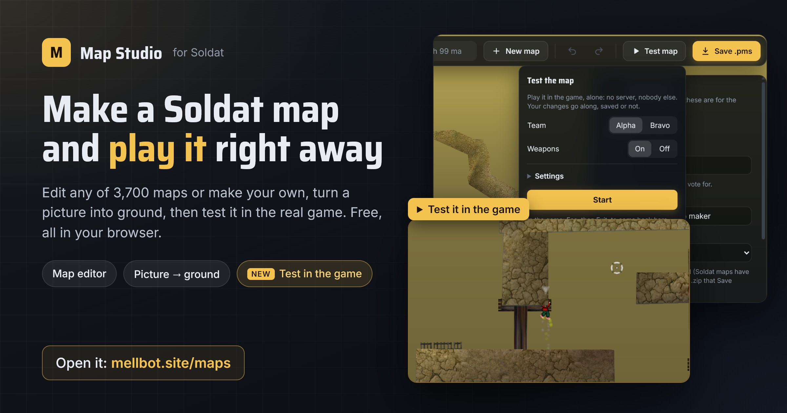
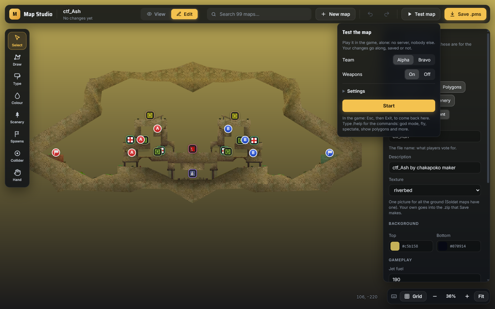
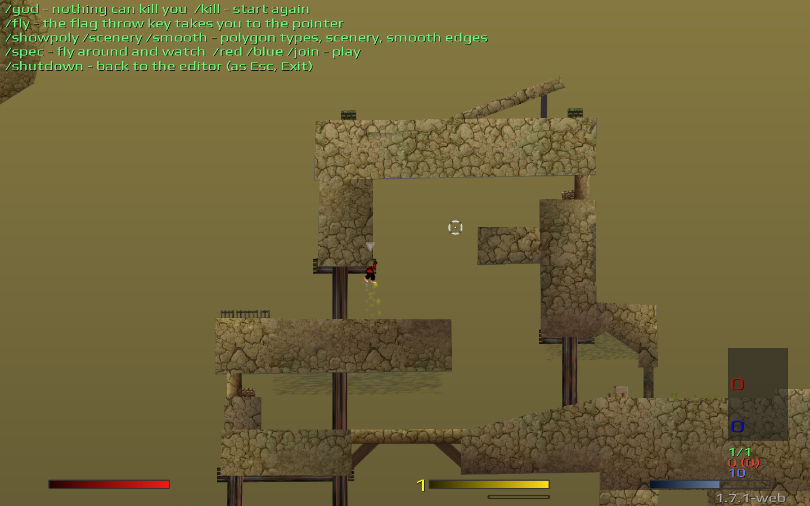

# Soldat Map Studio

**Make Soldat maps and play them in your browser.** A free map viewer and editor for Soldat, right
in your browser: look at any of 3,700 maps, edit them or make your own, turn any picture into
ground, **test the map in the real game without leaving the page**, and save a `.pms` that plays in
Soldat 1.7.1. No download, no install.

### ▶ Open it: **[mellbot.site/maps](https://mellbot.site/maps)**

Made by **mellbot.site**. This repository is the guide and a showcase: Map Studio itself is not
open source (see [Copyright](#copyright)).

---

## 🎮 New: test your map in the browser

Press **Test map** and you're in the game, on the map you're making, with your changes, saved
or not. It's Soldat itself running in the page: same physics, same weapons, same jets. Run the
route, try the jumps, check the spawns, then press **Esc → Exit** and keep editing where you
left off.

- **Pick a team and weapons**: Alpha or Bravo, weapons on or off.
- **Settings**: mouse sensitivity, volume, full screen, and your own **controls** (set them once,
  they're remembered).
- **Alone**: no server, nobody else. Nothing you test is sent anywhere.
- **Best looks**: smooth textures and edges, moving scenery and the map's weather, filling the
  whole window whatever its shape.

**Commands in the game** (type **/help** to see them):

| Command | What it does |
|---|---|
| `/god` | Nothing can kill you: deadly ground shows "You died", but you keep going |
| `/fly` | The flag throw key takes you to the pointer |
| `/kill` | Start again |
| `/showpoly` | Show the ground types in colour |
| `/scenery` | Scenery on or off |
| `/smooth` | Smooth polygon edges on or off |
| `/spec` | Spectate: fly around the map with the mouse |
| `/red` · `/blue` · `/join` | Play again (on a team map: red or blue) |
| `/shutdown` | Back to the editor (as Esc, Exit) |

Press **T** to see all the messages.

---

## ✨ Make ground from any picture

Drawing ground around a detailed picture, corner by corner, takes hours. Map Studio does it in
one click:

1. Place a picture on the map: a tree, a rock, a building, a logo, your own drawing.
2. Select it and press **Make ground from this picture**.
3. The studio finds the picture's outline and cuts it into polygons, holes and all. You see them
   in gold before anything is added.
4. Choose how detailed, the ground type (normal, ice, deadly, bouncy ...) and the look: invisible
   ground under the picture, or real ground with the map's texture. Press **Add**.

It works with transparent PNGs, Soldat's green-background BMPs, and even JPGs and photos with a
plain background (it removes the background colour). Fix anything by hand on the preview, zoomed
in as far as you like.

**Pictures that work best**: side-view game art with a see-through background (platforms, rocks,
cliffs, islands, silhouettes), or a solid shape on one plain colour, with sharp edges. Photos with
busy backgrounds, soft shadows and thin lines work less well.

---

## What it does

- **See any map**: search about 3,700 maps (Soldat's own and the climb map pack) or open a
  `.pms`, `.smap` or `.zip` from your computer. It's drawn the way the game draws it: textures,
  scenery, spawn points, flags, items and colliders.
- **Understand a map**: light up each ground type (deadly, ice, bouncy, only bullets collide ...)
  and click a polygon to see everything about it.
- **Make maps**: draw ground, paint ground types and colours, place scenery, spawns, flags, items
  and colliders, then save a `.pms` that works in Soldat 1.7.1.
- **Test them**: play the map in the game, in the same page, at any moment.
- **Pixel perfect**: a grid down to 1 map unit, snapping to the grid and to other corners,
  exact X / Y boxes, and the position shown live while you drag.
- **Make ground from a picture**: pick a scenery picture and the studio cuts polygons in its shape,
  even from photos with a plain background.
- **Copy and paste**: between places in a map, or from one map into another.
- **Your own pictures and textures**: add them from your computer; the map is then saved as a
  `.zip` with everything it needs.
- **Your files stay with you**: the maps and pictures you open stay in your browser. When you save,
  a small picture of the map goes to mellbot.site (kept 7 days). Work in progress is kept
  as a draft, so closing the page loses nothing.

---

## How to use it

### 1. Open a map
- Type a map's name in **Search maps** at the top, or press **Open file** for one on your computer.
- **New map** starts an empty one.
- **Share** copies a link to the map you're looking at.

### 2. Look around
- Drag to move, use the mouse wheel to zoom, and press **Fit** (or **F**) to see the whole map.
- The panel on the right (**What to show**) switches the background, polygons, textures, scenery
  levels, spawn points, colliders and wireframe on and off. In Edit, the same **The map** switches
  are at the top of **Map settings**. What is switched off can't be clicked or selected, and
  **Ctrl+A** leaves it out.
- Under **Ground types in this map**, click a type to light it up, or **Light all**.

### 3. Edit
Press **Edit** at the top, or **Edit a copy** on the map card. Then pick a tool on the left:

| Tool | Key | What it does |
|---|---|---|
| **Select** | V | Click to select, drag around things to select several. Drag to move, drag a corner to reshape. **Corners** (K) selects single corners of polygons. |
| **Draw** | D | Draw ground: **Box**, **Free** shape, **Ramp** or **Spike**, with its ground type and colour. |
| **Type** | T | Paint the ground type: click or drag over polygons. |
| **Colour** | C | Paint colours on whole polygons, or on corners for smooth light and shadow. |
| **Scenery** | S | Pick a picture (or add your own), then click on the map to place it. |
| **Spawns** | P | Player spawns, flags and items. |
| **Collider** | O | Invisible circles that stop bullets. |
| **Hand** | H | Move around the map (or hold Space). |

**Ctrl + drag works with every tool**: it moves the one thing under the pointer, without
leaving the tool you're using.

**With something selected** (Select tool), the panel and the right-click menu have:
- **Duplicate**, **Copy** and **Delete** (paste with **Ctrl+V**, in this map or another)
- **X** and **Y**: the exact place of a spawn point, collider or scenery item (or of the corners
  selected), to read or type in
- **Snap to**: **Grid** and **Corners**, on or off
- **Arrange**: bring to front, bring forward, send backward, send to back
- **Turn and flip**: rotate 180°, 90° either way, flip horizontally or vertically
- **Size**: ½, −10%, +10%, ×2, or drag a corner of the dashed box around the selection
- **Colour**: copy a colour from anything on the map with the pipette, then **Paint the selection**
- The ground type, scenery level (Back / Middle / Front), opacity, size and turn

**With nothing selected**, **Map settings** has the map's name, description, texture,
background colours and gameplay settings, with one-click jet fuel amounts (**None** to
**Infinite**).

### 4. Draw, on the grid
The **Grid** button by the zoom shows the grid. In the **Draw** panel's **Helpers**:
- **Snap to other corners** and **Snap to grid**: new corners, moved things, spawns, colliders and
  scenery land on corners near them or on the grid. When you move polygons, the corner nearest to
  where you grabbed them lands on the grid, and any moving corner sticks to a corner it meets.
- **Square size**: any size from **1** map unit (as fine as Soldat allows) to 256, or one click on
  1, 4, 8, 16, 32 or 64.
- **Strong line every**: a stronger line every so many squares (1 = none).
- **Grid lines**: their colour and how strong they are.

The bar at the bottom shows where the pointer is, and while you drag, where the thing lands and
how far it moved (a box's size while you draw one).

### 5. Scenery and your own pictures
In the **Scenery** tool, browse **In this map**, **All** pictures or **Yours**. **+ Add your own
pictures** takes `.png`, `.bmp`, `.jpg` or `.gif` from your computer. Drag a corner of a placed
picture to resize it.

Scenery has three levels, as in the game: **Back** (behind the ground and the players), **Middle**
(behind the ground, in front of the players) and **Front** (in front of everything).

### 6. Ground from a picture
Select one scenery picture and press **Make ground from this picture**. The gold lines show the
polygons before anything is added.

- **Background**: **See-through** uses the picture's transparency (transparent PNGs, and Soldat's
  bright-green BMPs); **Colour** removes the background colour, for pictures without
  transparency; **Rectangle** uses the whole picture.
- **Tolerance**, **Also inside the picture** and **Clean up** fine-tune what is removed.
- Fix what it got wrong on the preview: **Background** (click a colour to remove it), **Keep** and
  **Remove** (paint). **⤢** opens the picture big, with zoom.
- **Detail**: from exact to simple (fewer polygons).
- **Look**: **Invisible** keeps the picture as it is and players stand on its shape; **Map
  texture** makes real visible ground.

Undo (↶) takes back any change; Start over (↺) goes back to the first result.

### 7. Test it
Press **Test map** at the top: pick a team, weapons on or off, and **Start**. See
[Test your map in the browser](#-new-test-your-map-in-the-browser).

### 8. Save and play
Press **Save .pms** (or **Ctrl+S**). Put the file in Soldat's `maps` folder, or on your server.
A map that uses your own pictures saves as a **.zip** (`maps/`, `scenery-gfx/`, `textures/`):
unzip it into the Soldat folder.

---

## Keyboard shortcuts

All of them are in the studio too: press **?**, or the keyboard button by the zoom. On a Mac,
Cmd works as Ctrl.

| Keys | Does |
|---|---|
| V K D T C S P O H | Select, Corners on/off, Draw, Type, Colour, Scenery, Spawns, Collider, Hand |
| Ctrl + drag | Move the one thing under the pointer, with any tool |
| Shift + click | Add to the selection, or take away |
| Ctrl+A | Select all you can see |
| Ctrl+Z / Ctrl+Y (or Ctrl+Shift+Z) | Undo / redo |
| Ctrl+C / Ctrl+X / Ctrl+V | Copy / cut / paste (also into another map) |
| Ctrl+D | Duplicate |
| Ctrl+S | Save |
| Delete | Delete what is selected |
| Arrow keys (Shift = 10) | Nudge |
| R / Shift+R | Rotate 90° clockwise / counter-clockwise |
| F / Shift+F | Flip horizontally / vertically |
| ] / [ | Bring forward / send backward |
| Shift+] / Shift+[ | Bring to front / send to back |
| I, or Alt+click | Copy a colour from the map |
| Enter, Backspace | Free shape: finish it, take the last corner back |
| + / − | Zoom in / out |
| F (nothing selected) | Show the whole map |
| Esc | Close, cancel, or clear the selection |
| ? | All the shortcuts |

---

## Copyright

**Map Studio © 2026 mellbot.site. All rights reserved.**

Map Studio is not open source. This repository only holds this guide and its screenshots; the
program's code is not published here or anywhere else, and copying, changing, redistributing or
reusing it (in whole or in part) needs written permission from mellbot.site. See [LICENSE](LICENSE).

Soldat and its graphics (the maps, textures, scenery and item pictures in the screenshots) belong
to their makers: Soldat was created by Michal Marcinkowski, © Transhuman Design.
