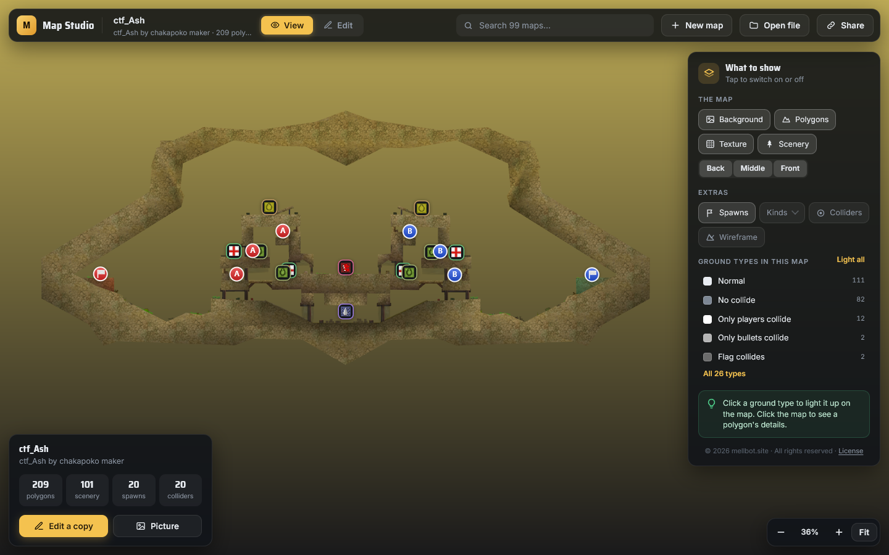
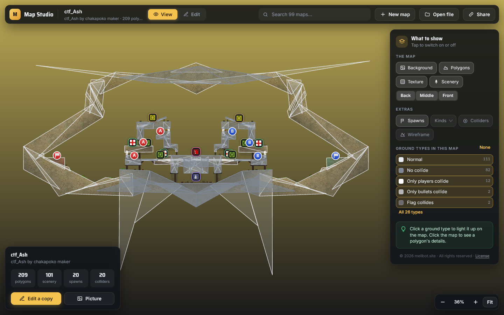
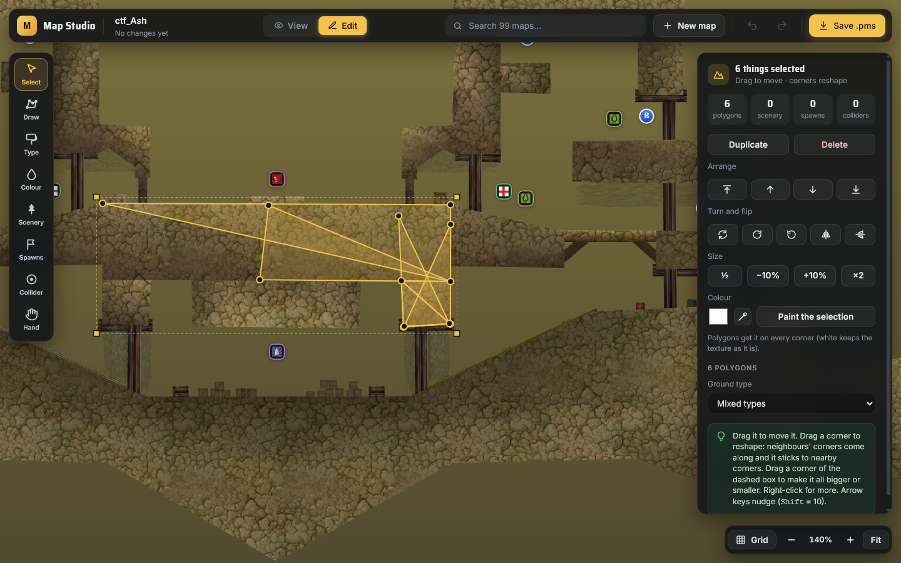
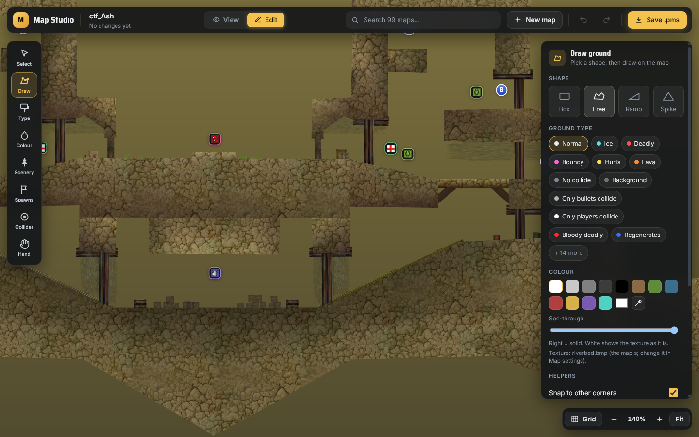
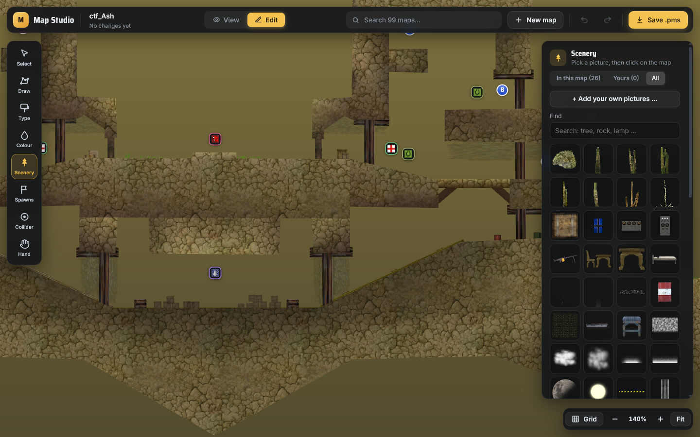
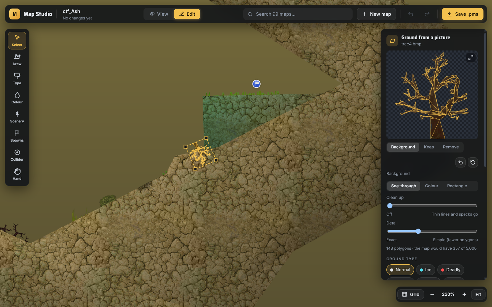
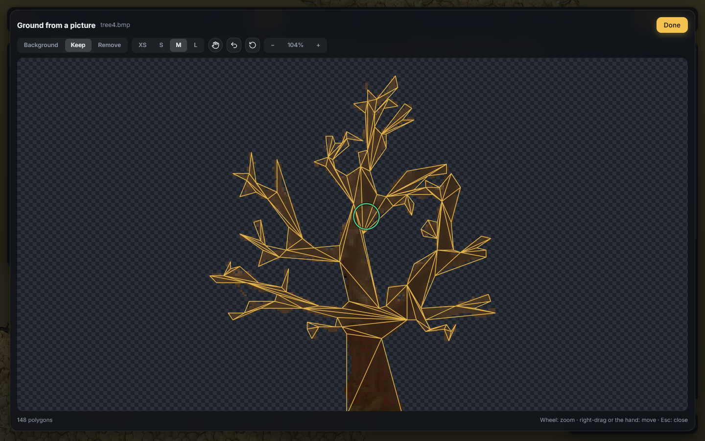

# Soldat Map Studio

**Look at any Soldat map in your browser, and make your own.** No download, no install: open the
page, pick a map or start a new one, and save a `.pms` that plays in Soldat.

### ▶ Open it: **[mellbot.site/maps](https://mellbot.site/maps)**
(also at [tv.mellbot.site/maps](https://tv.mellbot.site/maps))

Made by **mellbot.site**. This repository is the guide and a showcase: Map Studio itself is not
open source (see [Copyright](#copyright)).

---

## What it does

- **See any map**: search about 3,700 maps (Soldat's own and the climb map pack) or open a
  `.pms`, `.smap` or `.zip` from your computer. It's drawn the way the game draws it: textures,
  scenery, spawn points, flags, items and colliders.
- **Understand a map**: light up each ground type (deadly, ice, bouncy, only bullets collide ...)
  and click a polygon to see everything about it.
- **Make maps**: draw ground, paint ground types and colours, place scenery, spawns, flags, items
  and colliders, then save a `.pms` that works in Soldat 1.7.1.
- **Make ground from a picture**: pick a scenery picture and the studio cuts polygons in its shape,
  even from photos with a plain background.
- **Your own pictures and textures**: add them from your computer; the map is then saved as a
  `.zip` with everything it needs.
- **Nothing is uploaded**: your maps and pictures stay in your browser. Work in progress is kept
  as a draft, so closing the page loses nothing.

---

## How to use it

### 1. Open a map
- Type a map's name in **Search maps** at the top, or press **Open file** for one on your computer.
- **New map** starts an empty one.
- **Share** copies a link to the map you're looking at.

### 2. Look around
- Drag to move, use the mouse wheel to zoom, and press **Fit** (or **F**) to see the whole map.
- The panel on the right (**What to show**) switches the background, polygons, textures, scenery
  levels, spawn points, colliders and wireframe on and off.
- Under **Ground types in this map**, click a type to light it up, or **Light all**.

### 3. Edit
Press **Edit** at the top, or **Edit a copy** on the map card. Then pick a tool on the left:

| Tool | Key | What it does |
|---|---|---|
| **Select** | V | Click to select, drag around things to select several. Drag to move, drag a corner to reshape. |
| **Draw** | D | Draw ground: **Box**, **Free** shape, **Ramp** or **Spike**, with its ground type and colour. |
| **Type** | T | Paint the ground type: click or drag over polygons. |
| **Colour** | C | Paint colours on whole polygons, or on corners for smooth light and shadow. |
| **Scenery** | S | Pick a picture (or add your own), then click on the map to place it. |
| **Spawns** | P | Player spawns, flags and items. |
| **Collider** | O | Invisible circles that stop bullets. |
| **Hand** | H | Move around the map (or hold Space). |

**With something selected** (Select tool), the panel and the right-click menu have:
- **Duplicate** and **Delete**
- **Arrange**: bring to front, bring forward, send backward, send to back
- **Turn and flip**: rotate 180°, 90° either way, flip horizontally or vertically
- **Size**: ½, −10%, +10%, ×2, or drag a corner of the dashed box around the selection
- **Colour**: copy a colour from anything on the map with the pipette, then **Paint the selection**
- The ground type, scenery level (Back / Middle / Front), opacity, size and turn

### 4. Scenery and your own pictures
In the **Scenery** tool, browse **In this map**, **All** pictures or **Yours**. **+ Add your own
pictures** takes `.png`, `.bmp`, `.jpg` or `.gif` from your computer. Drag a corner of a placed
picture to resize it.

Scenery has three levels, as in the game: **Back** (behind the ground and the players), **Middle**
(behind the ground, in front of the players) and **Front** (in front of everything).

### 5. Ground from a picture
Select one scenery picture and press **Make ground from this picture**. The gold lines show the
polygons before anything is added.

- **Background**: **See-through** uses the picture's transparency (transparent PNGs, and Soldat's
  bright-green BMPs); **Colour** removes the background colour, for pictures without
  transparency; **Rectangle** uses the whole picture.
- **Tolerance**, **Also inside the picture** and **Clean up** fine-tune what is removed.
- Fix what it got wrong on the preview: **Background** (click a colour to remove it), **Keep** and
  **Remove** (paint). **⤢** opens the picture big, with zoom.
- **Detail**: from exact to simple (fewer polygons).
- **Look**: **Invisible** keeps the picture as it is and players stand on its shape; **Map
  texture** makes real visible ground.

Undo (↶) takes back any change; Start over (↺) goes back to the first result.

### 6. Save and play
Press **Save .pms** (or **Ctrl+S**). Put the file in Soldat's `maps` folder, or on your server.
A map that uses your own pictures saves as a **.zip** (`maps/`, `scenery-gfx/`, `textures/`):
unzip it into the Soldat folder.

---

## Keyboard shortcuts

| Keys | Does |
|---|---|
| V D T C S P O H | Select, Draw, Type, Colour, Scenery, Spawns, Collider, Hand |
| Ctrl+Z / Ctrl+Y | Undo / redo |
| Ctrl+S | Save |
| Ctrl+D | Duplicate |
| Ctrl+A | Select all |
| Delete | Delete what is selected |
| Arrow keys (Shift = 10) | Nudge |
| R / Shift+R | Rotate 90° clockwise / counter-clockwise |
| F / Shift+F | Flip horizontally / vertically |
| ] / [ | Bring forward / send backward |
| Shift+] / Shift+[ | Bring to front / send to back |
| I, or Alt+click | Copy a colour from the map |
| + / − | Zoom in / out |
| F (nothing selected) | Show the whole map |
| Esc | Close, cancel, or clear the selection |

---

## Copyright

**Map Studio © 2026 mellbot.site. All rights reserved.**

Map Studio is not open source. This repository only holds this guide and its screenshots; the
program's code is not published here or anywhere else, and copying, changing, redistributing or
reusing it (in whole or in part) needs written permission from mellbot.site. See [LICENSE](LICENSE).

Soldat and its graphics (the maps, textures, scenery and item pictures in the screenshots) belong
to their makers: Soldat was created by Michal Marcinkowski, © Transhuman Design.
